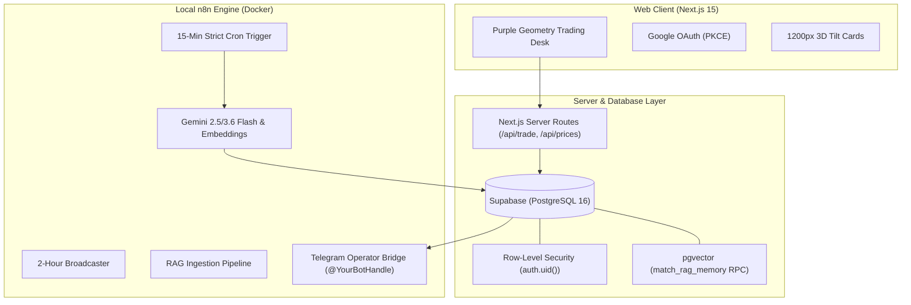

# Quant Terminal: Autonomous Market Scanner & Multi-Tenant Trading Desk

A high-performance algorithmic trading simulator and market intelligence terminal combining **Next.js 15 (App Router)**, **Supabase (pgvector & RLS)**, **n8n Local Docker Automation**, and **Google Gemini Flash / Text-Embedding-004**.

---

## 1. System Architecture



---

## 2. Visual Design System: "Purple Geometry"

The web terminal is styled according to the **Purple Geometry** visual identity:
- **Palette**:
  - Cosmic Obsidian: `#07040d` (Deep space base)
  - Elevated Glass Surface: `#0f091d` (75% opacity with 20px blur)
  - Primary Accent: Neon Violet `#a855f7`
  - Secondary Accent: Cyber Cyan `#38bdf8`
  - Highlighting Accent: Fuchsia `#d946ef`
  - Positive Profit Indicator: Emerald `#4ade80`
- **Geometric Grid**: 48px grid overlay (`rgba(168, 85, 247, 0.04)`) with ambient radial violet glows.
- **3D Tilt Cards**: 1200px depth perspective with Emil Kowalski spring easing (`cubic-bezier(0.16, 1, 0.3, 1)`) and dynamic cursor glare.

---

## 3. Core Operational Invariants & Hard-Won Learnings

### A. Strict Cron vs. Rolling Intervals (Schedule Drift Prevention)
- **Gotcha**: Using `field: "minutes"` with rolling timers causes trigger drift on every cycle due to node execution overhead.
- **Rule**: Always configure `field: "cronExpression"` with strict clock quarters:
  ```json
  "rule": {
    "interval": [
      {
        "field": "cronExpression",
        "expression": "0,15,30,45 * * * *"
      }
    ]
  }
  ```

### B. n8n Container Deployment & Hot Reload
- Running `n8n import:workflow` sets workflows to `active: false`.
- Publishing via `n8n publish:workflow --id=<ID>` stages the version, but a running n8n node process caches workflows in memory.
- **Always restart n8n** (`docker restart n8n-app`) and verify the startup log:
  ```text
  Activated workflow "Quant Terminal: Active Quant Engine (15-Min Cron)" (ID: qpVYXMzvSohhsH_t)
  ```

### C. Multi-Symbol Fan-Out Multiplication Trap
- If a ticker node returns multiple items (e.g. BTC, ETH, SOL, DOGE), connecting it directly to a database or messaging node causes $N$ consecutive executions.
- Always aggregate data into a single payload using a Code node before passing to downstream subscriber loops.

### D. LLM Resilience & Retries
- HTTP nodes calling LLM APIs (Gemini) must have:
  - `retryOnFail: true`
  - `maxTries: 3`
  - `waitBetweenTries: 1000`
  - `continueOnFail: true`
- Downstream nodes must parse defensively with fallback paths for rate-limiting or service outages.

### E. RAG Vector Search Cold-Start
- If `rag_memory` is unpopulated, vector search returns empty results. Use `rag_ingestion_pipeline.json` or `scripts/ingest_rag_documents.py` to seed foundational market context and maintain similarity thresholds between `0.30` and `0.45`.

### F. Client-Side Tamper Resistance
- Frontends never dictate balances or execute raw SQL. All transactions route through server routes or RPCs protected by Supabase Row-Level Security (RLS) bound to `auth.uid()`. Inspecting or modifying DOM in browser developer tools has zero effect on ledger state.

---

## 4. Local Development

```bash
# Start local web development server
npm run dev

# Inspect n8n Docker status
docker ps --filter "name=n8n"

# Verify n8n logs
docker logs n8n-app --tail 50
```
